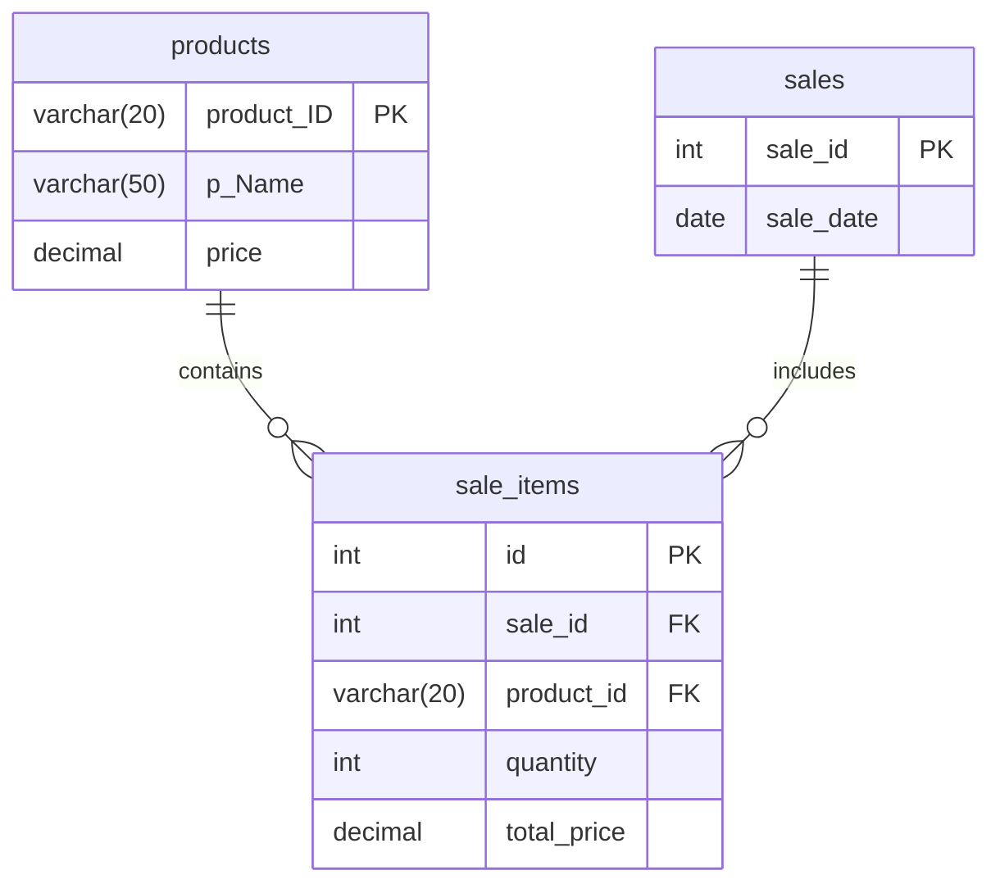

# 📊 AI-Powered Sales Analyzer

[](https://python.org)
[](https://mysql.com)
[](https://ai.google.dev/)
[](https://docs.python.org/3/library/tkinter.html)
[](https://matplotlib.org/)

An intelligent desktop sales management and analytics application featuring a **Tkinter** graphical interface, **MySQL** database backend, **Matplotlib** visual analytics, and an integrated **AI Sales Assistant** powered by **Google Gemini AI** that translates natural language questions into SQL queries.

---

## 🚀 Key Features

### 💼 1. Product & Inventory Management
- **Add Products**: Easily register products with unique ID, Name, and Unit Price.
- **Product Catalog**: View all inventory items in a structured, sortable Treeview table.

### 🧾 2. Sales Transactions & Records
- **Record Sales**: Log transactions with automatic date capture, multi-item tracking, and instant total price calculation.
- **Sales History**: Query past sales, line items, and quantities sold.

### 📈 3. Visual Analytics & Reporting
- **Sales Trend Analysis**: Graph total sales volume across dates.
- **Product Performance**: Visualize best-selling products.
- **Date-Specific Deep Dive**: Filter and chart revenue for any specific date.
- **Product Revenue Breakdown**: Compare revenue contributions by product.

### 🤖 4. AI-Powered Sales Assistant
- **Natural Language to SQL**: Ask questions in plain English (e.g., *"What is our total revenue?"*, *"Which product generated the most sales?"*).
- **Gemini 2.5 Flash-Lite Integration**: Generates optimized MySQL queries on the fly, queries the database, and presents clean, actionable insights directly in the chat window.

---

## 🗄️ Database Architecture

The application uses three normalized relational tables in MySQL:



---

## 🛠️ Tech Stack

- **Frontend**: Python Tkinter, Pillow (PIL)
- **Backend**: Python 3.10+
- **Database**: MySQL Server (`mysql-connector-python`)
- **Visual Analytics**: Matplotlib
- **AI Engine**: Google Gemini API (`google-genai` SDK)
- **Environment Management**: `python-dotenv`

---

## 📦 Project Structure

```plaintext
├── Analyzer.py            # Main GUI application & dashboard
├── sales_chatbot.py       # AI Sales Assistant (Gemini API + MySQL)
├── sales.sql              # Database schema definition
├── requirements.txt       # Project dependencies
├── .env.example           # Environment template (safe for version control)
├── .gitignore             # Git ignore rules for secrets and caches
├── salesanalyzer_bg.png   # Application dashboard artwork
├── SALES.mp4              # Application demo video
└── README.md              # Project documentation
```

---

## ⚙️ Installation & Setup

### 1. Clone the Repository
```bash
git clone https://github.com/sreeharivj852-Lone/AI-Powered-Sales-Analyzer.git
cd AI-Powered-Sales-Analyzer
```

### 2. Create a Virtual Environment (Optional but Recommended)
```bash
python -m venv venv
# On Windows:
venv\Scripts\activate
# On macOS/Linux:
source venv/bin/activate
```

### 3. Install Dependencies
```bash
pip install -r requirements.txt
```

### 4. Database Setup
Ensure MySQL is running on your machine, then create and initialize the database using the provided schema:
```bash
mysql -u root -p < sales.sql
```

### 5. Configure Environment Variables
Copy the `.env.example` file to create your `.env`:
```bash
cp .env.example .env
```
Open `.env` in a text editor and enter your credentials:
```env
GEMINI_API_KEY=your_gemini_api_key_here
DB_HOST=localhost
DB_USER=root
DB_PASSWORD=your_mysql_password
DB_NAME=sales
```
> [!NOTE]
> You can generate a free Gemini API key from [Google AI Studio](https://aistudio.google.com/).

---

## 🎮 Running the Application

Launch the main application dashboard:
```bash
python Analyzer.py
```

From the dashboard you can:
- Click **Add Product** / **View Products** to manage inventory.
- Click **Enter Sales** / **View Sales** to handle transactions.
- Click **Graphs** to launch visual sales analytics.
- Click **AI Assistant** to chat with the Gemini-powered sales intelligence bot.

---

## 🔒 Security Best Practices

- All sensitive API keys and database credentials are kept out of version control via `.env` and `.gitignore`.
- Queries generated by the AI assistant are restricted strictly to read-only `SELECT` statements to safeguard data integrity.

---

## 📄 License
This project is open source and available under the [MIT License](LICENSE).
