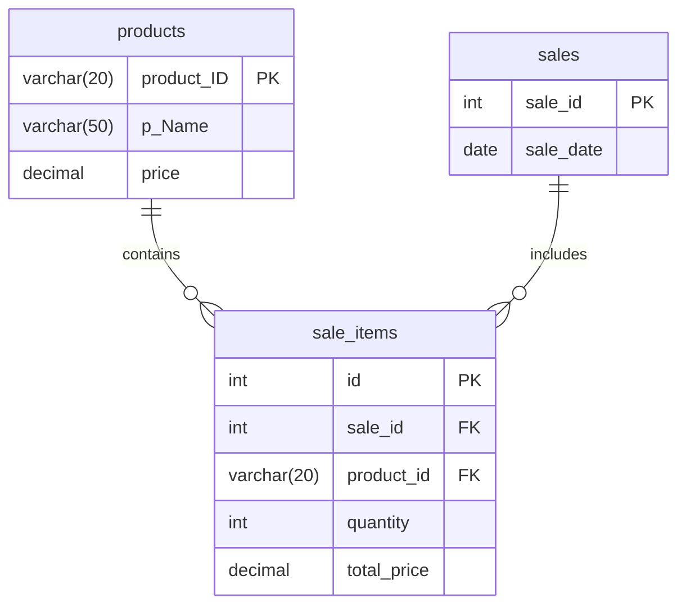

# 📊 AI-Powered Sales Analyzer

[](https://python.org)
[](https://mysql.com)
[](https://ai.google.dev/)
[](https://docs.python.org/3/library/tkinter.html)
[](https://github.com/andialbrecht/sqlparse)
[](https://matplotlib.org/)

An enterprise-ready desktop sales management and business intelligence application featuring a **Tkinter** graphical dashboard, **MySQL** relational database, **Matplotlib** analytics visualizations, and an intelligent **AI Sales Assistant** powered by **Google Gemini 2.5 Flash-Lite** that safely translates natural language questions into secure SQL queries.

---

## 🏗️ Application Architecture

The system follows a modular, layered architecture emphasizing separation of concerns and defense-in-depth security:

```
┌─────────────────────────────────────────────────────────────┐
│                      Tkinter GUI Layer                      │
│   ┌───────────────────────────┐ ┌───────────────────────┐   │
│   │  Analyzer.py (Dashboard)  │ │ sales_chatbot.py (UI) │   │
│   └─────────────┬─────────────┘ └───────────┬───────────┘   │
└─────────────────┼───────────────────────────┼───────────────┘
                  │                           │ (Threaded Worker)
                  │                           ▼
                  │               ┌───────────────────────┐
                  │               │ Gemini API Integration│
                  │               └───────────┬───────────┘
                  │                           │ Raw SQL Query
                  │                           ▼
                  │               ┌───────────────────────┐
                  │               │   sql_validator.py    │
                  │               │ (AST & Token Checker) │
                  │               └───────────┬───────────┘
                  │                           │ Validated & Sanitized SQL
                  ▼                           ▼
┌─────────────────────────────────────────────────────────────┐
│                     Database Layer (db.py)                  │
│       - Environment Variable Validation (.env)              │
│       - Connection Pool & Context Managers                  │
│       - Automatic Transaction Rollback & Resource Cleanup   │
│       - Optional Dedicated Read-Only Chatbot Account        │
└──────────────────────────────┬──────────────────────────────┘
                               │
                               ▼
┌─────────────────────────────────────────────────────────────┐
│                   MySQL Relational Database                 │
│         products    ───<    sale_items    >───    sales     │
└─────────────────────────────────────────────────────────────┘
```

---

## 🔒 Security Architecture: How AI-to-SQL Works

Relying exclusively on prompt instructions ("*please only generate SELECT queries*") to enforce security in production AI systems is insufficient because LLMs can be jailbroken, hallucinate, or be manipulated by adversarial user inputs. This project uses a **multi-layered Defense-in-Depth strategy**:

```
[User Question]
      │
      ▼
┌───────────────────────────────┐
│ Layer 1: Prompt Constraints   │ Enforces read-only instructions in Gemini prompt.
└─────────────┬─────────────────┘
              │ Generated SQL
              ▼
┌───────────────────────────────┐
│ Layer 2: AST Token Validator  │ Strict AST analysis using sqlparse:
│     (sql_validator.py)        │ • Rejects multiple statements (len == 1)
└─────────────┬─────────────────┘ • Rejects modifying commands (INSERT, UPDATE, DELETE, DROP, etc.)
              │                   • Rejects comments (-- , /* */, #) and system vars (@@)
              │                   • Rejects dangerous primitives (OUTFILE, SLEEP, BENCHMARK)
              │                   • Enforces table whitelist: {products, sales, sale_items}
              │                   • Appends safe row limit (LIMIT 50)
              │ Sanitized SQL
              ▼
┌───────────────────────────────┐
│ Layer 3: Read-Only DB User    │ (Optional/Recommended) Chatbot connects using
│       (MySQL Engine)          │ a dedicated user with SELECT-only grants.
└───────────────────────────────┘
```

### 1. Natural Language to SQL Translation
When the user submits a query (e.g., *"What is our total revenue?"*), the query is packaged into a structured system prompt supplied with the schema definitions of `products`, `sales`, and `sale_items`.

### 2. Independent AST SQL Validation (`sql_validator.py`)
Before any query touches the database, it must pass validation checks:
- **Single Statement Enforcement**: Rejects chained queries (e.g., `SELECT 1; DROP TABLE products;`).
- **Strict SELECT Type**: Rejects any statement whose root AST token is not `SELECT`.
- **Modifying Command Blacklist**: Deep recursive token walk checking for `INSERT`, `UPDATE`, `DELETE`, `DROP`, `ALTER`, `TRUNCATE`, `CREATE`, `REPLACE`, `GRANT`, `REVOKE`, `CALL`, `EXEC`, etc.
- **Dangerous Construct Rejection**: Prohibits file exports (`INTO OUTFILE`), time delays (`SLEEP`, `BENCHMARK`), comments (`--`, `/*`, `#`), and system variables (`@@`).
- **Schema & Table Whitelist**: Only permits queries targeting `products`, `sales`, and `sale_items`. Any attempt to access system tables (`mysql.user`, `information_schema.tables`) is rejected.
- **Enforced Row Limit**: Automatically appends `LIMIT 50` if no row limit is specified, protecting against memory exhaustion.

### 3. Read-Only Database Account (Defense-in-Depth)
Even if an application-level validator were bypassed, the database engine enforces isolation when configured with a read-only user (`sales_readonly`).

---

## 🗄️ Database Schema

The database consists of three normalized tables:



---

## ⚡ UI Responsiveness & Background Threading

In desktop applications, synchronous network requests freeze the GUI, causing Windows to mark the window as *"Not Responding"*.

- **Decoupled Execution**: All Gemini API calls and MySQL queries in `sales_chatbot.py` run in background daemon threads (`threading.Thread`).
- **Main Thread Scheduling**: All GUI updates are safely routed back to Tkinter's main event loop using `win.after(0, callback)`.
- **User Feedback**: The Send button and text input are disabled during query execution to prevent race conditions and duplicate submissions, and a visual status label displays execution progress.

---

## 🛠️ Project Structure

```plaintext
sales_ANALYZER/
├── Analyzer.py            # Main application GUI & analytics dashboard
├── sales_chatbot.py       # AI Sales Assistant (threading & orchestration)
├── db.py                  # Database connection, config validation, context managers
├── sql_validator.py       # Strict SQL parser and security validator
├── result_formatter.py    # Formats SQL query outputs for readable display
├── sales.sql              # Database schema & read-only user setup
├── requirements.txt       # Project dependencies
├── .env.example           # Safe environment variable template
├── .gitignore             # Git ignore rules for secrets and caches
├── salesanalyzer_bg.png   # Dashboard background image
├── SALES.mp4              # Application demonstration video
├── tests/                 # Comprehensive unit test suite
│   ├── __init__.py
│   ├── test_sql_validator.py     # SQL acceptance, rejection & injection tests
│   ├── test_result_formatter.py  # Results formatting and NULL handling tests
│   ├── test_db_config.py         # Config validation & connection tests
│   └── test_chatbot_flow.py      # End-to-end integration mock tests
└── README.md              # Project documentation
```

---

## ⚙️ Installation & Setup

### 1. Clone the Repository
```bash
git clone https://github.com/sreeharivj852-Lone/AI-Powered-Sales-Analyzer.git
cd AI-Powered-Sales-Analyzer
```

### 2. Create and Activate a Virtual Environment
```bash
# Windows:
python -m venv venv
venv\Scripts\activate

# macOS/Linux:
python3 -m venv venv
source venv/bin/activate
```

### 3. Install Dependencies
```bash
pip install -r requirements.txt
```

### 4. Database Initialization
Ensure your MySQL server is running, then initialize the database:
```bash
mysql -u root -p < sales.sql
```

#### Optional: Create Dedicated Read-Only User for AI Chatbot
```sql
CREATE USER IF NOT EXISTS 'sales_readonly'@'localhost' IDENTIFIED BY 'YourSecurePassword123!';
GRANT SELECT ON sales.* TO 'sales_readonly'@'localhost';
FLUSH PRIVILEGES;
```

### 5. Configure Environment Variables
Copy the template to create your `.env` file:
```bash
cp .env.example .env
```
Edit `.env` and configure your credentials:
```env
# Google Gemini API Key (https://aistudio.google.com/)
GEMINI_API_KEY=your_actual_gemini_api_key_here

# MySQL Database Connection
DB_HOST=localhost
DB_PORT=3306
DB_NAME=sales
DB_USER=root
DB_PASSWORD=your_actual_mysql_password

# Optional: Read-only user for AI Chatbot
# CHATBOT_DB_USER=sales_readonly
# CHATBOT_DB_PASSWORD=YourSecurePassword123!
```

---

## 🎮 Running the Application

Launch the main application dashboard:
```bash
python Analyzer.py
```

### Dashboard Features:
- **ADD PRODUCT**: Register new items (ID, Name, Price).
- **VIEW PRODUCTS**: Browse current inventory in a tabular Treeview.
- **ENTER SALE**: Record sales with transaction date and items.
- **VIEW SALES**: Review past sales transactions.
- **SALES GRAPH**: Interactive line chart of revenue trends over time.
- **PRODUCT GRAPH**: Trend of quantity sold for an individual product.
- **DATE GRAPH**: Daily breakdown of products sold.
- **PRODUCT REVENUE**: Single-product revenue contribution bar chart.
- **AI ASSISTANT**: Chatbot interface for natural-language business queries.

---

## 🧪 Running the Test Suite

The project includes unit and integration tests covering SQL parsing, security validation, database configurations, and result formatters.

Run all tests:
```bash
python -m unittest discover -s tests -v
```

Expected result:
```
Ran 43 tests in ~0.12s
OK
```

---

## ⚠️ Known Limitations & Future Improvements

### Current Limitations:
1. **Network Dependency for Chatbot**: The AI assistant requires an active internet connection to contact Google's Gemini API endpoints.
2. **Read-Only Chatbot**: The chatbot intentionally supports only read operations (`SELECT`). Modifications (e.g., *"Add 5 more apples"*) are disallowed to prevent accidental data corruption.
3. **Local MySQL Dependency**: The desktop client expects a reachable MySQL database instance.

### Planned Improvements:
- **Local LLM Fallback**: Support offline local models (such as Ollama / LLaMA 3) when an internet connection is unavailable.
- **Data Export**: Export analytics and chatbot query tables to CSV and Excel (`xlsxwriter`).
- **Connection Pooling**: Implement `mysql.connector.pooling` for multi-user network setups.
- **Role-Based Access Control (RBAC)**: Login and authorization screens separating store clerks from administrators.

---

## 📄 License
This project is open source and available under the [MIT License](LICENSE).
